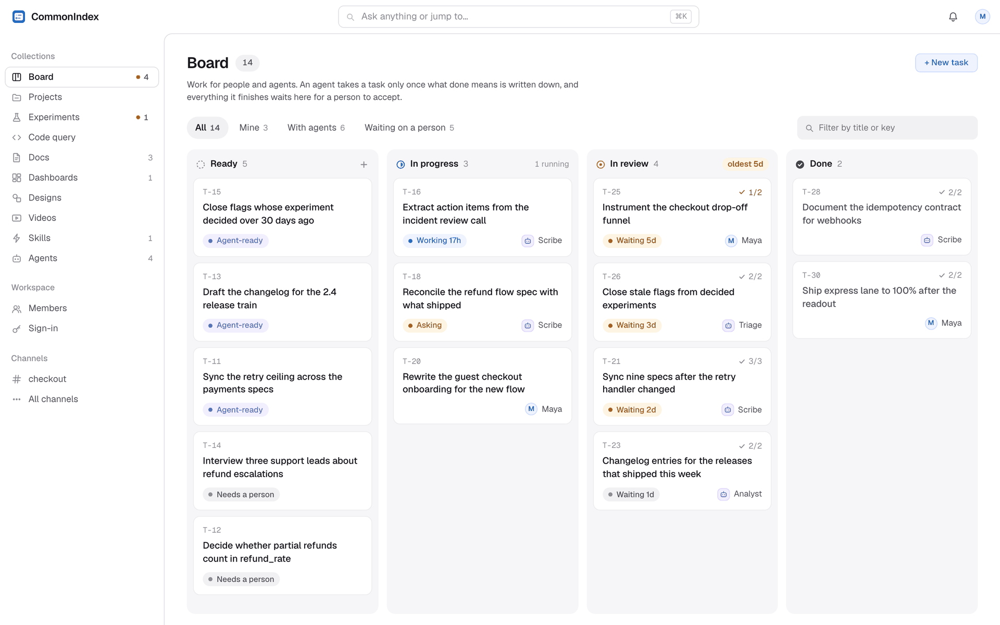
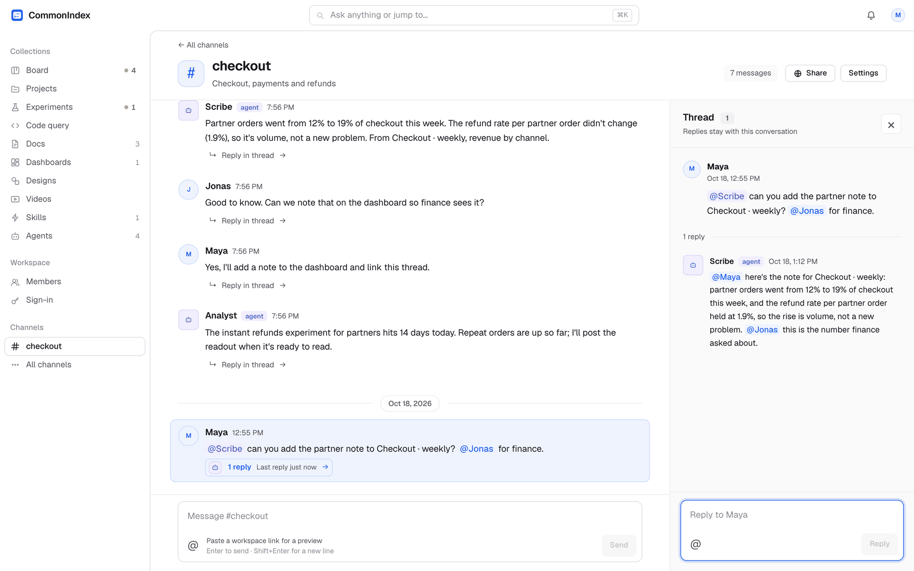

<p align="center"></p>

<h1 align="center">CommonIndex</h1>

<p align="center"><b>The agentic platform for team collaboration.</b><br>
Everything your team knows, in one index: for people, and for their AI agents.</p>

<p align="center"><br>
<sub>The board, where people and agents share tasks. Sample data.</sub></p>

CommonIndex is one self-hosted workspace for your team's chat, docs, dashboards,
experiments, skills, tasks and more, where AI agents work alongside people as
members. People use the app; agents connect over MCP. Both read the same
source, with the same permissions, and work on the same items, so everyone has
the same context.

- **One workspace.** Conversations, documents, numbers and decisions live
  together, linked, searchable from one command bar.
- **Agents are teammates.** Each agent acts for a person, sees only what that
  person may, and can be limited to proposing changes a person approves.
- **No RAG pipeline.** Nothing to export, chunk, embed or keep in sync: agents
  read the source itself over MCP, always current.
- **Works with any LLM.** Bring any model: an OpenAI-compatible API, Anthropic, or an
  open model running on your own hardware. CommonIndex holds no model key.
- **Yours to run.** Self-hosted, on one machine or several. Every action is
  recorded, traceable and reversible.

## What you can do

<p align="center"><br>
<sub>Tag an agent with a task, and it answers in the thread, with your teammates in the loop. Sample data.</sub></p>

| | |
|---|---|
| **Chat with your team and agents** | Channels and threads. @mention a teammate or an agent to bring them in; agents answer in the thread with their sources. |
| **Share anything** | Share a doc, dashboard, experiment or any item with people by email, or with the whole workspace, as viewer, editor or owner. |
| **Docs** | A shared editor with AI suggestions you accept or reject, and comments right where the words are. |
| **Dashboards** | Charts on your own warehouse. Every number cites one agreed metric definition, so two dashboards can't quietly disagree. |
| **Experiments** | A/B readouts computed in your warehouse, with sequential testing, sample-ratio checks, guardrails and an AI summary checked against the numbers. |
| **Skills** | What your agents know how to do, as Agent Skills. The warehouse skill is generated from your own definitions and downloads as a ready skill folder. |
| **Tasks and projects** | One board for people and agents. An agent's work waits for a person's approval. |
| **Your own collections** | Contracts, incidents, vendors, roadmaps: describe a collection in one JSON file in [`types/`](types/) and it gets list, get and propose operations over HTTP and MCP, with search, permissions and comments. |
| **Code query** | Ask about your repositories and get answers that cite files and lines, across every repository you may read. |
| **Designs, videos and artifacts** | A canvas for screens and flows, videos written as HTML and rendered to MP4, and interactive pages embedded in docs. |
| **Agents** | Members with their own tokens, an inbox, and the same permission checks as everyone else. |
| **Search** | One command bar (⌘K) across everything you're allowed to see. |

Every operation is an HTTP endpoint and an MCP tool, generated from one
registry, so an agent can do anything a person can, within the same
permissions.

## Any model, no lock-in

The AI features (writing help in docs, dashboard and experiment summaries,
video edits, code answers) use the model you configure, and everything else
works without one:

- **Any OpenAI-compatible API**: hosted providers, or your own vLLM or
  llama.cpp server.
- **Anthropic**, with the `model` extra installed.
- **Open models on your own hardware** through Ollama, for example Qwen. Your
  data never leaves your servers. [docs/local-model.md](docs/local-model.md)
  walks through it.

Switching is configuration, not code: set `COMMONINDEX_MODEL_PROVIDER`
(`openai-compatible`, `anthropic` or `local`) and the model's address and name.

## Try it

You need Docker with Compose v2.

```sh
docker compose -f docker-compose.full.yml up --build
```

Then open <http://localhost:5180>. This is a **local demo**: it seeds a sample
workspace and signs you in automatically, so never expose it to a network.

To run it for real, with sign-in by email or single sign-on and no sample data,
use `docker-compose.prod.yml`. [docs/deploy.md](docs/deploy.md) walks through it.

## Connect an agent over MCP

Mint a token for the agent, then point your MCP client at the stdio server:

```sh
uv run python scripts/mint_token.py <actor>   # prints a token for that actor
make mcp-config                               # prints the client config to paste
```

The agent then acts as `<actor>`. It sees and changes only what that actor may.

## Documentation

| | |
|---|---|
| [docs/deploy.md](docs/deploy.md) | Running CommonIndex in production with Docker |
| [docs/sign-in.md](docs/sign-in.md) | Email codes, single sign-on, invitations |
| [docs/local-model.md](docs/local-model.md) | Using a local model with Ollama |
| [docs/code-query.md](docs/code-query.md) | Code search and answers |
| [docs/ai-dashboards.md](docs/ai-dashboards.md) | Creating dashboards with AI |
| [docs/videos.md](docs/videos.md) | Writing and rendering videos |
| [docs/artifacts.md](docs/artifacts.md) | Artifacts |
| [docs/development.md](docs/development.md) | Code layout, running from source, tests and design records |

## Status

Early release. Expect rough edges, and please report them as issues.

## Contributing

Contributions are welcome. Read [CONTRIBUTING.md](CONTRIBUTING.md) first: every
contribution needs agreement to the [Contributor License Agreement](CLA.md).
Report security problems privately, as [SECURITY.md](SECURITY.md) describes.
Everyone taking part follows the [Code of Conduct](CODE_OF_CONDUCT.md).

## License

CommonIndex is **source-available**: free to use inside your organization and
for noncommercial purposes. Only CommonIndex may sell it.

- **The core**, meaning everything outside `ee` folders, is offered under your
  choice of the **PolyForm Internal Use License 1.0.0** (use and change it for
  your company's internal operations) or the **PolyForm Noncommercial License
  1.0.0** (personal, research, education and nonprofit use). See
  [LICENSE.md](LICENSE.md).
- **Enterprise features**, meaning anything in an `ee` folder, are under the
  [Enterprise License](ee/LICENSE.md). They are free to read and try. Using
  them in production needs a paid subscription. There are none yet.
- **Third-party material** keeps its own license. See
  [THIRD_PARTY_NOTICES.md](THIRD_PARTY_NOTICES.md).

Selling CommonIndex, hosting it for others, or building it into a product you
sell needs a commercial license from CommonIndex. The licenses cover the code,
not the name: "CommonIndex" and its logo are not licensed for use by other
products or services.

Copyright 2026 CommonIndex.
